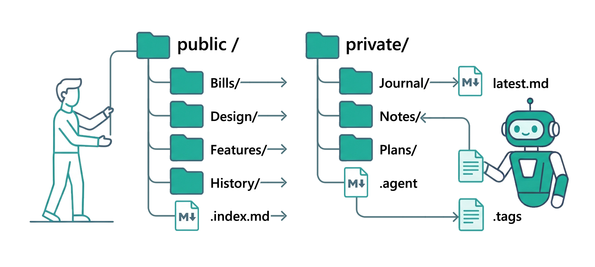

<p align="center">
  
</p>

# AgentContext

A template for keeping what your organisation knows in one git repository, in a shape that coding agents and new hires can both read. It ships a method and an empty structure: you deploy it once and fill it with your own products, decisions and designs. Written for a founder or a small team. MIT licensed.

> **_TL;DR:_** Yet another system of small indexed Markdown files, with two trees (one for what is true, and the other for how the work was run on a given machine), a tool for searching the trees, a linter that keeps their shapes honest, and a deployer which an agent can drive.

_see [ARCHITECTURE.md](./ARCHITECTURE.md) for the full explaination version._

## Get it

Hand the job to your coding agent. Paste this into a fresh session, with your own path and organisation filled in:

```
Set up a knowledge tree for <organisation> at <path>, from the AgentContext template.
Fetch https://raw.githubusercontent.com/AWCostabile/AgentContext/v0.4.0/SETUP.md and follow
it as a run-sheet: ask me its questions first, then run each step's command and confirm its
check before moving on. If a step refuses, stop and show me what it said.
```

[SETUP.md](./SETUP.md) is written for exactly that reader: every step is one command and one check, and it ends with how to pull a later release into your tree without touching what you have filed. To read the template itself:

```
git clone https://github.com/AWCostabile/AgentContext.git
```

## What you get

- **A skeleton**, in `template/`, that maps onto your instance's root: indexes, tags, and templates for a branch, a leaf, a product and its private mirror. Every directory is a branch with one `.index.md`, one `.tags` and single-topic leaves.
- **Two trees.** `public/` is what is true and is shared; `private/` is how the work was run on one machine, a nested repository the parent ignores. Links run one way, and the feature log is the one crossing.
- **The scripts**, in `scripts/`: `cure.sh` fails on a broken invariant, `smell.sh` warns on what needs judgement, `find.sh` resolves tags and keywords to the right leaf. `template/HYGIENE.md` lists every check; `template/rules/` states the grammar.
- **A deployer**, `init.sh`, with an update mode that replaces the core files you never edited and keeps the ones you did, through a manifest it records at install.
- **An instruction for agents**, `template/AGENTS.md`, that an instance carries at its root; the core never names a harness.
- **Modules**, optional: a constitution (seed rulings, articles and the process half of agent-led work), a code-map generator with TypeScript and Go extractors, a GitHub Actions workflow that turns every merged pull request into a squash commit and a change-log entry, and a Graphify knowledge graph per repository, kept in the tree and linked back into each repository.
- **Adapters**, keyed by harness: Claude Code written (a pre-write guard on the immutable tiers, a lint after every write, orientation at session start, skills and agent profiles); Codex, Cursor and Gemini CLI as porting specs.
- **A worked example**, `examples/quillfeather/`, a fictional startup's filled tree with generated code maps, so you can see the indexes with something in them.

## If Claude Code is your agent

The Claude Code adapter gives an instance its guard on the immutable tiers, its lint after every write and its orientation at session start. For the machine itself, [AWCostabile/claude-memory-setup](https://github.com/AWCostabile/claude-memory-setup) is the complement: a four-system persistent memory for Claude Code, set up once system-wide with one pasted prompt, so every session starts where the last one left off. The two fit together: the tree holds what the organisation knows, the memory holds what your own sessions learned.

## Read next

- [ARCHITECTURE.md](./ARCHITECTURE.md): the method in full, section by section.
- [CHANGE_LOG.md](./CHANGE_LOG.md): what each release landed, generated from the pull requests.
- [SETUP.md](./SETUP.md): the run-sheet, deploying and updating.
- [template/AGENTS.md](./template/AGENTS.md): what an instance tells an agent.
- [template/HYGIENE.md](./template/HYGIENE.md): every check, what it means and how to fix it.
- [The example's reader page](./examples/quillfeather/README.md): a filled tree, and what to open first.

## Licence

MIT. See [LICENSE](./LICENSE).
